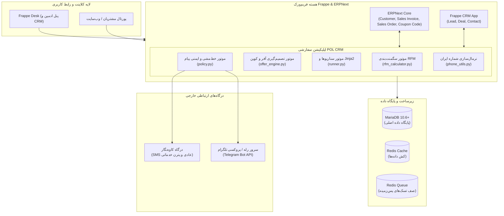
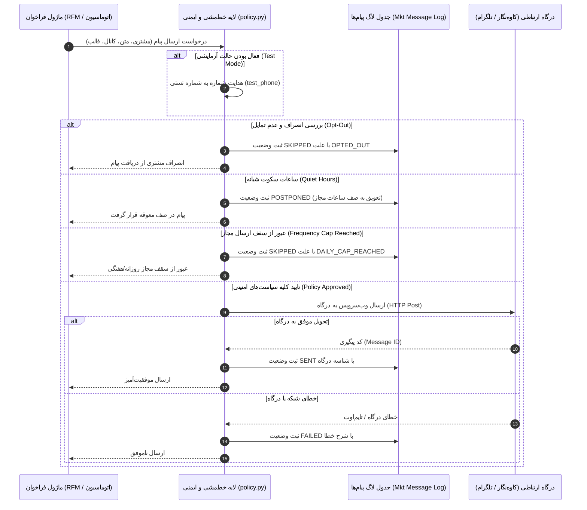
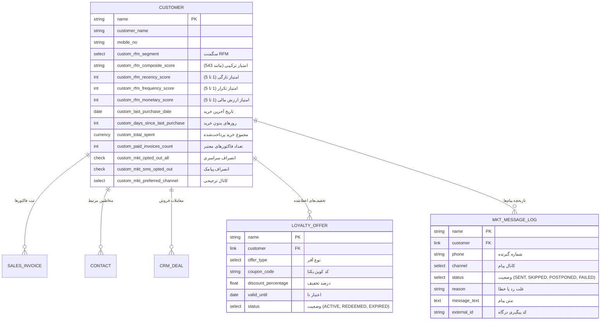
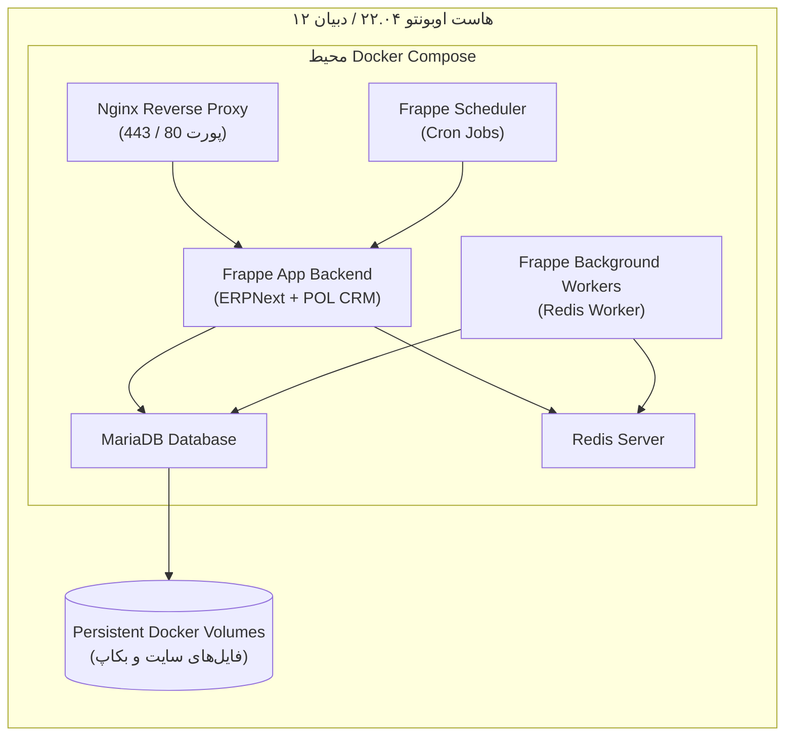

# سند مشخصات نیازمندی‌های سیستم (Software Requirements Specification - SRS)
## سامانه جامع CRM، وفاداری مشتریان (RFM) و اتوماسیون بازاریابی POL CRM
### بازمعماری و مهاجرت از Twenty CRM به اکوسیستم Frappe Framework / ERPNext

---

| مشخصه | شرح |
| :--- | :--- |
| **عنوان پروژه** | سامانه POL CRM (مهاجرت از Twenty CRM به Frappe & ERPNext) |
| **نسخه سند** | 1.0.0 |
| **وضعیت** | مصوب (Approved) |
| **سطح محرمانگی** | سازمانی / داخلی |
| **تاریخ تدوین** | پاییز ۱۴۰۳ (۲۰۲۶) |
| **چارچوب استاندارد** | IEEE 830 / ISO/IEC/IEEE 29148 |

---

## ۱. مقدمه و اهداف پروژه (Introduction & Project Objectives)

### ۱.۱. هدف سند (Purpose)
این سند، مشخصات جامع، دقیق و رسمی نیازمندی‌های کارکردی (Functional) و غیرکارکردی (Non-Functional) پروژه بازمعماری و مهاجرت سامانه ارتباط با مشتریان و اتوماسیون بازاریابی از **Twenty CRM** به پلتفرم بومی سازمانی **Frappe Framework / ERPNext** را تشریح می‌کند. این مستند به عنوان مرجع فنی مشترک برای تیم‌های توسعه نرم‌افزار، مهندسی داده، تضمین کیفیت (QA)، مدیران محصول و مدیران بازاریابی تدوین شده است.

### ۱.۲. پیشینه و ضرورت مهاجرت (Business Context & Background)
در معماری قبلی، سازمان از ترکیب سیستم Twenty CRM به همراه دو اکستنشن جداگانه (`crmloyality` برای محاسبه امتیازات وفاداری و سگمنت‌بندی RFM، و `twenty-automation` برای اجرای سناریوهای پیام‌رسانی) استفاده می‌کرد. این رویکرد با چالش‌های ساختاری زیر مواجه بود:
1. **جدایی داده‌های بازاریابی از هسته عملیاتی و فروش:** سیستم فروش و فاکتورها در نرم‌افزار مالی/ERP جداگانه نگهداری می‌شد و همگام‌سازی آن‌ها با Twenty CRM سربار و تاخیر بالا ایجاد می‌کرد.
2. **عدم انطباق بومی با زیرساخت‌های داخل ایران:** وابستگی به وب‌سرویس‌های خارجی در ارسال پیام‌ها و عدم وجود راهکار مقاوم در برابر فیلترینگ و قطعی شبکه (مانند ارسال پترن خدماتی پیامک و پروکسی تلگرام).
3. **هزینه‌های نگهداری چند سامانه مجزا:** نیازمندی به پایگاه‌های داده و سرورهای مختلف، چالش‌های همگام‌سازی داده‌ها و ریسک عدم تطابق داده‌های وفاداری و مالی.

### ۱.۳. اهداف کلان راهکار جدید (Core Objectives)
- **یکپارچه‌سازی در هسته ERPNext:** اتصال مستقیم محاسبات وفاداری و سناریوهای بازاریابی به اسناد مالی و فروش بومی (`Sales Invoice`, `Sales Order`, `Customer`, `Contact`, `CRM Deal`).
- **توسعه اپلیکیشن بومی Frappe (`pol_crm`):** پیاده‌سازی متمرکز موتور تحلیل RFM، موتور تخفیف هوشمند، درگاه‌های ارتباطی محلی (کاوه‌نگار خدماتی و تلگرام با قابلیت رله)، و موتور خط‌مشی ایمنی پیام‌رسانی در یک ماژول واحد.
- **مهاجرت امن و بدون اتلاف داده‌ها (Zero Data Loss):** انتقال ساختاریافته بیش از ده‌ها هزار رکورد مشتری، کالا، سفارش و اقلام سفارش از فایل‌های استخراجی Twenty به فریم‌ورک Frappe.
- **تضمین کیفیت مستقل و با سرعت بالا (High-Speed Automated QA):** بهره‌گیری از معماری آزمون‌های ایزوله Mocking طبق سند ADR 0001 با اجرای ۱۱۴ تست کامل در کمتر از ۰.۲۵ ثانیه بدون وابستگی به دیتابیس خارجی.

### ۱.۴. واژه‌نامه و اصطلاحات تخصصی (Glossary)

| اصطلاح | معادل انگلیسی | تعریف در سیستم |
| :--- | :--- | :--- |
| **تحلیل RFM** | RFM Analysis | مدل بخش‌بندی مشتریان بر اساس ۳ متغیر: تازگی خرید (Recency)، تکرار خرید (Frequency) و ارزش ریالی خرید (Monetary). |
| **سگمنت چرخه حیات** | Lifecycle Segment | یکی از ۱۱ گروه رفتاری استاندارد مشتریان (مانند قهرمانان، در خطر، از دست رفته، مشتریان جدید و...). |
| **کد تخفیف پویا** | Dynamic Coupon | کدهای یک‌بار مصرف اختصاصی تولید شده بر اساس قوانین موتور آفر و ثبت شده در `Coupon Code` / `Pricing Rule`. |
| **ساعات سکوت** | Quiet Hours | بازه زمانی شبانه یا استراحت (طبق افق زمانی تهران) که در آن ارسال هرگونه پیام بازاریابی متوقف و به صف معوق منتقل می‌شود. |
| **سقف ارسال** | Frequency Capping | بیشینه تعداد پیام مجاز بازاریابی که یک مشتری در روز و هفته دریافت می‌کند تا از ایجاد خستگی (Ad Fatigue) جلوگیری شود. |
| **ارسال الگو / خدماتی** | Pattern / Verify SMS | ارسال پیامک از طریق خطوط اشتراکی خدماتی کاوه‌نگار با استفاده از توکن‌های از پیش‌تأییدشده که حتی به شماره‌های بلک‌لیست مخابراتی (عدم دریافت پیامک تبلیغاتی) تحویل داده می‌شود. |
| **سرور رله تلگرام** | Telegram Relay | سرور واسط یا میانجی جهت هدایت امن درخواست‌های بات تلگرام از سرورهای میزبانی داخل ایران. |
| **داک‌تایپ** | DocType | ساختار اصلی مدل‌سازی داده و فرم‌ها در فریم‌ورک Frappe معادل Table در دیتابیس و Model در MVC. |

---

## ۲. توصیف کلی سیستم و معماری فنی (System Architecture)

### ۲.۱. ساختار استقرار کانتینری (Docker Architecture)
سیستم از طریق بسته‌های رسمی `frappe_docker` به صورت ماژولار مستقر می‌گردد:
1. **سرویس `backend` (Gunicorn/Frappe Worker):** پردازش درخواست‌های وب و API های فریم‌ورک.
2. **سرویس `frontend` (Nginx Reverse Proxy):** توزیع بار، سرو فایل‌های استاتیک و اعمال هدرهای امنیتی HTTP.
3. **سرویس `websocket` (Frappe Socketio):** مدیریت هشدارهای بلادرنگ و به‌روزرسانی زنده فرم‌ها.
4. **سرویس‌های پردازش صف (`queue-default`, `queue-short`, `queue-long`):** اجرای کارهای پس‌زمینه ناهمگام مانند ارسال پیام‌ها و فراخوانی وب‌سرویس‌ها.
5. **سرویس زمان‌بند (`schedule`):** اجرای تسک‌های دوره‌ای (شبانه و ساعتی).
6. **سرویس‌های داده (`mariadb`, `redis-cache`, `redis-queue`):** ذخیره‌سازی داده‌های ساختاریافته و کشینگ.

### ۲.۲. ذینفعان و سطوح دسترسی (Stakeholders & RBAC)
- **مدیر ارشد بازاریابی (Marketing Manager):** طراحی سناریوها، تعیین سیاست‌های سکوت و سقف ارسال، تعیین بازه‌های تخفیف.
- **کارشناس بازاریابی و فروش (Sales / CRM Agent):** مشاهده سگمنت‌های RFM در دسک، مانیتورینگ وضعیت مشتری در پایپ‌لاین‌های فروش (`CRM Deal`).
- **مدیر سیستم و دوآپس (System Administrator):** تنظیمات اتصال درگاه‌های پیامکی و تلگرام، کلیدهای دسترسی، مانیتورینگ عملکرد و لاگ خطاهای سرور.
- **مشتریان نهایی (Customers):** دریافت پیام‌های شخصی‌سازی شده در زمان مناسب بدون پیام‌های هرز (Spam) و اعمال کدهای کوپن در خریدهای خود.

---

## ۳. پایپ‌لاین مهاجرت داده از Twenty CRM (ETL & Data Migration)

```mermaid
flowchart LR
    TwentyCSVs["داده‌های استخراجی Twenty CRM\n(خروجی CSV)"] --> Cleaner["اسکریپت پاک‌سازی و نگاشت\n(prepare_frappe_imports.py)"]
    
    subgraph Transformation ["فاز پالایش و تبدیل داده"]
        PhoneNorm["نرمال‌سازی شماره‌های موبایل به فرمت ایران"]
        Dedup["یکتاکردن نام‌های تکراری با Accounting Code"]
        EntitySplit["تفکیک اسناد مالی از اقلام فاکتور (Child Tables)"]
        Chunker["دسته‌بندی در بسته‌های ۱۰،۰۰۰ تایی"]
    end
    
    Cleaner --> Transformation
    Transformation --> FrappeReady["فایل‌های آماده درون‌ریزی\n(docs-for-import/frappe_ready)"]
    FrappeReady --> FrappeImporter["ابزار Data Import فریم‌ورک Frappe"]
    FrappeImporter --> ERPNextDB[("پایگاه داده ERPNext")]
```

### ۳.۱. نیازمندی‌های پالایش و نرمال‌سازی داده‌ها (Data Cleansing)
1. **نرمال‌سازی شماره‌های تماس:** تبدیل شماره‌های با پیشوند بین‌المللی (`989...` یا `+989...`) به فرمت استاندارد محلی ایران (`09...`) و جداسازی شماره‌های ثابت از همراه.
2. **یکتایی نام مشتریان (De-duplication):** در صورت وجود نام‌های خانوادگی تکراری، سیستم باید شناسه حسابداری (`Accounting Code`) را به انتهای نام مشتری به صورت `Name (Accounting Code)` الصاق کند تا خطای عدم یکتایی در Frappe برطرف گردد.
3. **حل وابستگی‌های جدولی (Parent-Child Table Mapping):** اتصال رکوردهای اقلام فاکتور (`export-19-order-items.csv`) به عنوان جدول فرعی (`items`) به فاکتورهای فروش والد (`export-18-orders.csv`) بر اساس شناسه سفارش.
4. **تقسیم به بسته‌های بهینه (Batching):** تقسیم فایل‌های حجیم به بخش‌های ۱۰,۰۰۰ رکوردی جهت جلوگیری از تایم‌اوت مرورگر و حافظه وب‌سرور هنگام ایمپورت از طریق وب‌یوآی.

---

## ۴. نیازمندی‌های کارکردی سیستم (Functional Requirements)

### ماژول ۱: موتور تحلیل و بخش‌بندی RFM مشتریان (`rfm`)

#### ۴.۱.۱. محاسبه متغیرهای سه‌گانه R، F و M
سیستم باید متغیرهای سه‌گانه را به ازای هر مشتری فقط بر اساس اسناد فروش قطعی و پرداخت‌شده (`Sales Invoice` با `docstatus=1`) محاسبه نماید:
- **تازگی خرید (Recency - R):** تعداد روزهای گذشته از تاریخ ثبت آخرین فاکتور پرداخت‌شده تا تاریخ جاری (`nowdate`).
  - مقدار ۱ (ضعیف‌ترین): بیش از ۱۸۰ روز
  - مقدار ۲: ۹۱ تا ۱۸۰ روز
  - مقدار ۳: ۶۱ تا ۹۰ روز
  - مقدار ۴: ۳۱ تا ۶۰ روز
  - مقدار ۵ (بهترین): کمتر یا مساوی ۳۰ روز
- **تکرار خرید (Frequency - F):** تعداد کل فاکتورهای ثبت‌شده و پرداخت‌شده مشتری در طول عمر.
  - مقدار ۱: دقیقاً ۱ فاکتور
  - مقدار ۲: ۲ تا ۳ فاکتور
  - مقدار ۳: ۴ تا ۶ فاکتور
  - مقدار ۴: ۷ تا ۱۲ فاکتور
  - مقدار ۵: بیش از ۱۲ فاکتور
- **ارزش مالی خرید (Monetary - M):** مجموع مبالغ پرداختی فاکتورهای معتبر (بر حسب ریال).
  - مقدار ۱: تا ۱,۰۰۰,۰۰۰ ریال
  - مقدار ۲: ۱,۰۰۰,۰۰۱ تا ۳,۰۰۰,۰۰۰ ریال
  - مقدار ۳: ۳,۰۰۰,۰۰۱ تا ۸,۰۰۰,۰۰۰ ریال
  - مقدار ۴: ۸,۰۰۰,۰۰۱ تا ۲۰,۰۰۰,۰۰۰ ریال
  - مقدار ۵: بیش از ۲۰,۰۰۰,۰۰۰ ریال

> [!NOTE]
> کلیه آستانه‌های عددی فوق باید در داک‌تایپ `RFM Settings` به صورت پارامتریک و بدون نیاز به تغییر در کد منبع قابل سفارشی‌سازی باشند.

#### ۴.۱.۲. ماتریس قطعی ۱۱ سگمنت چرخه حیات (Lifecycle Segments)
سیستم باید بر اساس ترکیب امتیازات R، F و M، سگمنت مشتری را بر اساس ماتریس تقدم‌دار زیر استخراج کند:

| ردیف | نام سگمنت | شرایط امتیازها (R, F, M) | شرح و استراتژی رفتار با مشتری |
| :---: | :--- | :--- | :--- |
| **۱** | `CHAMPIONS` | $R \ge 4 \land F \ge 4 \land M \ge 4$ | بهترین و وفادارترین مشتریان؛ نیازمند پاداش‌های VIP و ارتباط اختصاصی |
| **۲** | `CANT_LOSE` | $R \le 2 \land F \ge 4 \land M \ge 4$ | مشتریان بسیار ارزشمند که مدت‌هاست خرید نکرده‌اند؛ نیازمند پیگیری تلفنی و آفر جذاب |
| **۳** | `AT_RISK` | $R \le 2 \land F \ge 3 \land M \ge 3$ | مشتریان پرخرج که در حال فراموشی برند هستند؛ نیازمند کمپین بازگشت (Win-back) |
| **۴** | `LOYAL` | $R \ge 3 \land F \ge 4$ | خریداران باسابقه و مستمر؛ پیشنهاد محصولات مکمل و ارتقای عضویت |
| **۵** | `POTENTIAL_LOYALIST` | $R \ge 3 \land (2 \le F \le 3) \land M \ge 2$ | خریداران اخیر با خریدهای متعدد و خرج مناسب؛ تشویق به پیوستن به باشگاه مشتریان |
| **۶** | `NEW_CUSTOMERS` | $R = 5 \land F = 1$ | مشتریانی که برای اولین بار به تازگی خرید کرده‌اند؛ نیاز به پیام خوش‌آمدگویی و راهنمایی |
| **۷** | `PROMISING` | $R = 4 \land F = 1 \land M \ge 2$ | خریداران بار اول با سبد خرید درشت؛ پتانسیل بالا برای تبدیل به وفادار |
| **۸** | `NEED_ATTENTION` | $R = 3 \land (2 \le F \le 3)$ | مشتریان با فعالیت متوسط؛ نیاز به یادآوری و ایجاد انگیزه برای خرید مجدد |
| **۹** | `ABOUT_TO_SLEEP` | $R = 2 \land (2 \le F \le 3)$ | مشتریانی که فاصله زیادی از خرید قبلی گرفته‌اند؛ ریسک ریزش بالا |
| **۱۰** | `HIBERNATING` | $R \le 2 \land F \le 2$ | مشتریان کم‌خرج با فاصله طولانی از خرید؛ آفرهای اقتصادی با تخفیف ویژه |
| **۱۱** | `LOST` | سایر حالات (شرط نهایی) | مشتریان کاملاً غیرفعال و از دست رفته |

#### ۴.۱.۳. هوک‌های رخدادمحور و زمان‌بندی محاسبات
1. **هوک بلادرنگ ثبت و ابطال فاکتور (`on_submit` و `on_cancel`):** با ثبت یا لغو هر فاکتور فروش (`Sales Invoice` یا `Sales Order`)، تابع محاسبه RFM اختصاصی همان مشتری اجرا شده و فیلدهای امتیاز و سگمنت در جدول `Customer` به‌روزرسانی شود.
2. **پایش دسته‌ای شبانه (`nightly_recalculate_all_customers_rfm`):** اجرای خودکار در ساعت ۲ بامداد برای بازسنجی متغیر Recency کل پایگاه داده به دلیل گذشت یک روز تقویمی.
3. **همگام‌سازی فیلدهای سفارشی با CRM:** انتقال خودکار فیلد `custom_rfm_segment` به اسناد مرتبط `Contact` و کارت‌های فرصت در پایپ‌لاین فروش `CRM Deal`.
4. **محاسبه دسته‌ای دستی از طریق List View:** امکان انتخاب چندین مشتری در جدول مشتریان دسک فریم‌ورک و اجرای آنی محاسبه RFM از طریق اکشن‌های گروهی (Bulk Actions).

---

### ماژول ۲: موتور تصمیم‌گیری هوشمند آفرها و کدهای تخفیف (`offer_engine`)

#### ۴.۲.۱. الگوریتم تولید کوپن یکتا و خوانا
- **فرمت:** رشته ۶ کاراکتری تصادفی با پیشوند سفارشی (مانند `POL-XXXXXX`).
- **حذف نویسه‌های گمراه‌کننده:** کاراکترهای شبهه‌ناک شامل ارقام و حروف `0`, `O`, `1`, `I` به صورت قطعی از مجموعه کاراکترهای مجاز حذف شوند تا کاربر نهایی در تایپ کد پیامک‌شده دچار اشتباه نشود (`ABCDEFGHJKLMNPQRSTUVWXYZ23456789`).
- **یکپارچگی با ERPNext:** ثبت مستقیم در جدول استاندارد `Coupon Code` با تعریف تاریخ انقضا و اتصال به `Pricing Rule` جهت اعمال خودکار در هنگام صدور فاکتور.

#### ۴.۲.۲. قوانین واجدین شرایط دریافت آفر (Eligibility Matrix)
سیستم در اجرای شبانه (`daily_offer_decision_pass`) باید مشتریان را بر اساس قوانین زیر ارزیابی کند:

| سناریوی آفر | نوع تخفیف | درصد تخفیف | بازه روزهای فاصله از آخرین خرید | مدت اعتبار کوپن | دوره استراحت (Cooldown) | سقف اعطا |
| :--- | :---: | :---: | :---: | :---: | :---: | :---: |
| **مشوق خرید دوم (`SECOND_ORDER`)** | درصدی | ۱۵٪ | ۱۵ الی ۴۵ روز (دقیقاً ۱ خرید قبلی) | ۷ روز | ۶۰ روز | فقط ۱ بار در طول عمر |
| **وفاداران بالقوه (`POTENTIAL_LOYALIST`)** | درصدی | ۱۰٪ | ۷ الی ۶۰ روز | ۱۰ روز | ۴۵ روز | چندباره با رعایت Cooldown |
| **مشتریان در خطر ریزش (`AT_RISK`)** | درصدی | ۲۰٪ | ۳۰ الی ۱۲۰ روز | ۷ روز | ۶۰ روز | چندباره با رعایت Cooldown |
| **مشتریان طلایی غایب (`CANT_LOSE`)** | درصدی | ۲۵٪ | ۴۵ الی ۱۸۰ روز | ۵ روز | ۹۰ روز | چندباره با رعایت Cooldown |

---

### ماژول ۳: سیستم پیام‌رسانی چندکاناله و لایه خط‌مشی ایمنی (`messaging`)

#### ۴.۳.۱. قوانین لایه خط‌مشی و ایمنی (Safety Guardrails)
1. **ساعات سکوت شبانه (Quiet Hours):**
   - زمان مرجع ارسال باید مستقل از زمان ماشین سرور، با استفاده از تایم‌زون رسمی ایران (`Asia/Tehran`) محاسبه شود.
   - بازه پیش‌فرض سکوت: از ساعت **۲۱:۰۰ شب الی ۰۹:۰۰ صبح** روز بعد.
   - پیام‌های عادی در این بازه نباید لغو شوند؛ بلکه باید با وضعیت `POSTPONED` ذخیره گردند و در ساعت ۰۹:۰۱ صبح توسط جاب زمان‌بندی‌شده ساعتی (`process_postponed_messages`) به صورت خودکار ارسال شوند.
   - پیام‌های تراکنشی ضروری (`urgent=True` یا `category="transactional"`) مانند کدهای تایید هویت و رسید پرداخت، مشمول ساعات سکوت نبوده و بلافاصله ارسال می‌شوند.
2. **سقف بسامد ارسال (Frequency Capping):**
   - سقف پیش‌فرض روزانه: حداکثر ۱ پیام بازاریابی در ۲۴ ساعت به ازای هر مشتری.
   - سقف پیش‌فرض هفتگی: حداکثر ۲ پیام بازاریابی در ۷ روز به ازای هر مشتری.
   - در صورت تلاش برای ارسال بیشتر، پیام با وضعیت `SKIPPED` و علت `DAILY_CAP_REACHED` یا `WEEKLY_CAP_REACHED` مسدود شده و در لاگ ثبت می‌شود.
3. **مدیریت انصراف و لغو اشتراک (Consent & Opt-Out):**
   - پشتیبانی از انصراف سراسری (`custom_mkt_opted_out_all = 1`).
   - پشتیبانی از انصراف اختصاصی پیامک (`custom_mkt_sms_opted_out = 1`).
   - پشتیبانی از لغو اشتراک داک‌تایپ `Mkt Subscription`.
4. **حالت آزمایشی ایمن (Test Mode):**
   - در صورت فعال بودن `test_mode` در تنظیمات، کلیه پیام‌ها به جای شماره مشتری اصلی، به شماره آزمایشی مدیر سیستم (`test_phone`) ارسال می‌گردد تا از ارسال پیام‌های تصادفی در محیط‌های استیجینگ و تستی جلوگیری شود.

#### ۴.۳.۲. درگاه‌های ارتباطی و آداپتورها (Gateway Adapters)
- **آداپتور پیامک کاوه‌نگار (`kavenegar.py`):**
  - متد ارسال عادی: ارسال از خطوط اختصاصی متنی.
  - متد ارسال الگو / پترن خدماتی (`send_kavenegar_pattern`): تفکیک توکن‌ها (`token`, `token2`, ...) و ارسال از طریق وب‌سرویس اعتبارسنجی (Verify) کاوه‌نگار با تضمین عبور از بلک‌لیست تبلیغاتی اپراتورها.
  - تاب‌آوری شبکه: مدیریت کامل استثناهای `Timeout` و `ConnectionError` با کتابخانه `requests` و ممانعت از کرش دسک.
- **آداپتور تلگرام بات (`telegram.py`):**
  - ارسال متن به همراه دکمه‌های شیشه‌ای.
  - پشتیبانی بومی از سرور رله (`relay_url`) و اتصال پروکسی HTTP/HTTPS جهت عبور از فیلترینگ در سرورهای میزبانی شده در دیتاسنترهای داخلی ایران.
  - مدیریت خطای مسدودسازی توسط کاربر (شناسایی خطای `403 Forbidden: bot was blocked by the user` و ثبت آن در سیستم).

---

### ماژول ۴: اتوماسیون سناریوهای بازاریابی (`marketing_automation`)

#### ۴.۴.۱. تعریف سناریوها (`Mkt Scenario`)
امکان ثبت سناریوهای بازاریابی انعطاف‌پذیر با فیلدهای:
- عنوان سناریو (`scenario_name`) و وضعیت فعال/غیرفعال بودن (`enabled`).
- نوع تریگر (`trigger_type`):
  - `RFM_SEGMENT_CHANGE`: تریگر رخدادمحور به محض تغییر سگمنت RFM مشتری به یک سگمنت هدف مشخص.
  - `INACTIVITY`: تریگر اسکن زمان‌بندی‌شده برای مشتریانی با تعداد روزهای مشخص عدم خرید (مثلاً ۶۰ روز).
  - `FIRST_ORDER`: اولین خرید موفق مشتری.
  - `BIRTHDAY`: تبریک سالروز تولد مشتری.
- کانال ارتباطی (`channel`): پیامک (SMS)، تلگرام (TELEGRAM)، ایمیل یا واتساپ.
- قالب پیام متنی با پشتیبانی از Jinja2 و کد الگوی خدماتی (`template_code`).

#### ۴.۴.۲. موتور قالب‌سازی Jinja2 ایمن
- پشتیبانی از متغیرهای داینامیک نام مشتری، سگمنت قبلی، سگمنت جدید، کد کوپن، درصد تخفیف و اقلام سفارش.
- پیاده‌سازی مکانیزم Safe Fallback: در صورتی که کاربر قالب نامعتبر یا دارای خطای سینتکسی درج کند، برنامه نباید کرش کند؛ بلکه با ثبت هشدار در لاگر فریم‌ورک، متن خام الگو را ارسال می‌نماید.

---

## ۵. مدل‌های داده و ساختار جداول (Data Models & Schema)

### ۵.۱. فیلدهای سفارشی افزوده‌شده به هسته Frappe/ERPNext

### ۵.۲. داک‌تایپ‌های اختصاصی سامانه (`DocTypes`)
1. **`RFM Settings` (Single DocType):** تنظیمات سراسری پارامترها و بازه‌های روز و مبالغ R, F, M.
2. **`Loyalty Offer` (Standard DocType):** سابقه کوپن‌ها و آفرهای اعطا شده به مشتریان، وضعیت مصرف و تاریخ انقضا.
3. **`Messaging Settings` (Single DocType):** تنظیمات ساعات سکوت، سقف ارسال، حالت تستی و کلیدهای ارتباطی.
4. **`Mkt Message Log` (Standard DocType):** جدول لاگ مانیتورینگ و رهگیری دقیق تمام پیام‌ها با وضعیت ارسال.
5. **`Mkt Scenario` (Standard DocType):** کاتالوگ سناریوهای خودکارسازی بازاریابی، شروط و الگوهای متن پیام.
6. **`Mkt Subscription` (Standard DocType):** نگهداری وضعیت اشتراک یا لغو عضویت مشتریان در کانال‌های مختلف.

---

## ۶. نیازمندی‌های غیرکارکردی (Non-Functional Requirements)

### ۶.۱. کارایی و عملکرد (Performance & Scalability)
- **پردازش دسته‌ای سریع:** کوئری‌های محاسبه RFM در شب باید با استفاده از دستورات بهینه SQL (`GROUP BY`, `MAX(posting_date)`, `SUM(grand_total)`) اجرا شده و توانایی به‌روزرسانی ۱۰۰,۰۰۰ رکورد مشتری را در کمتر از ۳ دقیقه داشته باشد.
- **پردازش ناهمگام پیام‌ها:** فراخوانی وب‌سرویس‌های خارجی پیامک و تلگرام نباید در چرخه درخواست اصلی (HTTP Request/Response) مسدودکننده باشد و باید از صف‌های پس‌زمینه Redis Queue استفاده کند.

### ۶.۲. قابلیت اطمینان و تاب‌آوری (Reliability & Resilience)
- **تاب‌آوری در برابر خطاهای وب‌سرویس خارجی:** قطعی اینترنت، فیلترینگ تلگرام یا اختلال در سرور کاوه‌نگار نباید مانع از ثبت سفارش یا فاکتور مشتری در ERPNext گردد.
- **ایزولاسیون خطا در پردازش شبانه:** در صورتی که محاسبه RFM برای یک مشتری با خطای دیتابیس مواجه شود، سیستم باید خطا را لاگ کرده و بلافاصله به پردازش سایر مشتریان ادامه دهد.

### ۶.۳. امنیت و محرمانگی (Security & Compliance)
- **حفظ حریم خصوصی مشتریان:** عدم ارسال پیام‌های ناخواسته با تبعیت دقیق از خط‌مشی Opt-out و ساعات سکوت.
- **محافظت از توکن‌ها و کلیدهای درگاه:** کلیدهای API کاوه‌نگار و توکن‌های تلگرام نباید در دیتابیس به صورت متن آشکار بدون کنترل دسترسی نگهداری شوند؛ سیستم باید قابلیت خواندن این مقادیر از فایل تنظیمات محلی سرور (`site_config.json`) را دارا باشد.
- **کنترل دسترسی نقش‌محور (RBAC):** محدود کردن امکان ویرایش تنظیمات خط‌مشی و سناریوها فقط برای نقش‌های `System Manager` و `Marketing Manager`.

### ۶.۴. بومی‌سازی و الزامات منطقه‌ای (Localization)
- **پشتیبانی از ارقام فارسی و عربی:** ماژول `phone_utils` باید پیش از هرگونه پردازش، کلیه اعداد فارسی/عربی (`۰۱۲۳۴۵۶۷۸۹`) را به انگلیسی تبدیل کند.
- **تایم‌زون رسمی ایران:** مدیریت زمان سکوت و تقویم دوره‌ای دقیقاً بر پایه افق زمانی `Asia/Tehran` بدون وابستگی به ساعت سرورهای ابری خارجی (UTC).
- **انطباق با خطوط خدماتی مخابرات:** پشتیبانی کامل از وب‌سرویس پترن خدماتی جهت دریافت پیام‌ها توسط مشترکینی که تبلیغات پیامکی خط خود را مسدود کرده‌اند.

### ۶.۵. معماری تست، تضمین کیفیت و سرعت توسعه (Quality Assurance - ADR 0001)
- **تست‌های مستقل از زیرساخت (In-Memory Mocking):** طبق استاندارد ثبت‌شده در سند تصمیم معماری ADR 0001، کلیه منطق‌های تجاری (RFM، آفرها، ساعات سکوت، کاوه‌نگار، تلگرام، اتوماسیون) باید با فریم‌ورک شبیه‌ساز سبک `frappe_mock.py` بدون نیاز به راه‌اندازی دیتابیس MariaDB تست شوند.
- **شاخص پذیرش تست‌ها (Acceptance Metrics):**
  - پوشش ۱۰۰ درصدی ۱۱ سگمنت چرخه حیات مشتری در آزمون‌های واحد.
  - اجرای کامل ۱۱۴ آزمون خودکار در زمانی کمتر از ۰.۲۵ ثانیه.
  - پشتیبانی کامل از هر دو ابزار تست استاندارد پایتون: `pytest` و `python -m unittest`.

---

## ۷. نیازمندی‌های استقرار، مانیتورینگ و نگهداری (Deployment & DevOps)

1. **مدیریت نسخه‌ها و اپلیکیشن‌ها:** مدیریت اپلیکیشن‌های نصب‌شده بر روی بنچ از طریق فایل استاندارد `apps.json`:
   - `frappe/erpnext` (نسخه ۱۶)
   - `frappe/crm` (شاخه اصلی)
   - `emgghost/pol_crm.git` (شاخه master)
2. **برنامه زمان‌بندی پشتیبان‌گیری خودکار (Automated Backups):**
   - پشتیبان‌گیری کامل پایگاه‌داده MariaDB روزانه ۲ بار به همراه ذخیره در مسیر حفاظت‌شده.
   - نگهداری لاگ‌های سیستم در داک‌تایپ `Mkt Message Log` به همراه پالایش خودکار رکوردهای قدیمی‌تر از ۱۸۰ روز.
3. **مانیتورینگ و مشاهده‌پذیری:**
   - ارائه داشبورد اختصاصی در Frappe Desk برای نمایش زنده توزیع سگمنت‌های مشتریان (`pol_rfm_distribution`).
   - کارت‌های آماری سریع: تعداد مشتریان VIP، مشتریان در خطر ریزش، تعداد آفرهای فعال و حجم پیام‌های ارسال‌شده در روز.
